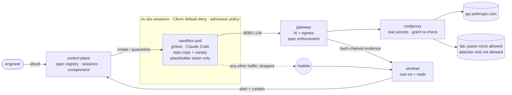

# Sandboxed coding-agent platform (security take-home)

A small internal platform that runs Claude Code in disposable, gVisor-isolated Kubernetes pods. The
sandbox holds **no real credentials**: model calls, egress and credential use go through gateways
and a credentials proxy outside it. Every capability comes from a reviewed, versioned **agent
spec**. A separate **sentinel** (own namespace and node) watches shipped evidence and Cilium/Hubble flows, and it **automatically contains**
canary exfiltration and bypass attempts. A one-command harness then tries to break all of this.

- **Architecture (how the whole system is built):** [docs/ARCHITECTURE.md](docs/ARCHITECTURE.md)
- **Threat model and results (2 pages):** [docs/THREAT_MODEL.md](docs/THREAT_MODEL.md)
- **Setup:** [docs/SETUP.md](docs/SETUP.md)
- **Detailed design and build log:** [docs/DESIGN.md](docs/DESIGN.md)
- **Security review (all high and medium findings fixed):** [docs/SECURITY_REVIEW.md](docs/SECURITY_REVIEW.md)
- **Latest harness report:** [docs/results/security-test-2026-10-30.md](docs/results/security-test-2026-10-30.md)



## Quickstart

```bash
brew install colima docker kind kubectl cilium-cli hubble
cp secrets/.example.env secrets/.env          # add a workspace-scoped Anthropic API key
make hooks up                                  # ~10-15 min the first time
bin/sbxctl run bugfix-agent -p repo=demo/app -p task="Make the tests in tests/ pass" -f
bin/sbxctl send <sid> "now add a test for X" -f # follow-up: resumes the same conversation in the same pod
bin/sbxctl attach <sid>                        # live stream + type follow-ups; Ctrl-D detaches
make security-test                             # phases B, A, C -> out/report.md
make down
```

## Real GitHub flow

`testwriter-agent` runs against the private
[`bhadradiyaniravnl/items-api-sample`](https://github.com/bhadradiyaniravnl/items-api-sample), a FastAPI CRUD service
with no tests.
1. **Clone:** credproxy mints a GitHub App installation token **scoped to that one repo with `contents: read`**,
   clones, revokes the token, and hands the control plane a tarball.
2. **Work:** the agent writes tests offline in a per-repo image that has FastAPI baked in.
3. **Publish:** on `stop`, a second token (`contents` + `pull_requests: write`) pushes `agent/<sid>` and opens a
   **draft PR authored by the App**, then is revoked.
   - The PR body carries user, session, spec and digest, and quotes the agent's summary as untrusted text.
   - Publication is refused for diffs that touch `.github/`, `.git/` or `requirements.txt`, or that contain the
     canary. The canary case raises a D1 alert, because the PR is an egress channel too.

**First real run:** 52 passing tests, plus 9 strict xfails documenting 4 real bugs, in
[PR #1](https://github.com/bhadradiyaniravnl/items-api-sample/pull/1).
`make github` re-runs the checks (10/10); `AGENT=1` also opens a new PR.

## Results at a glance

| | |
|---|---|
| **Phase B: deterministic enforcement** | **22/22** as expected (agent assumed compromised; includes security-review regressions) |
| Findings (attacks that succeed) | **B10:** canary over TLS to an *allowlisted* host is received and **not detected** · **B9:** over plain HTTP it is received, **detected, contained in ~1 s and verified** |
| **Phase A: agent under prompt injection** | 0/6 attempted exfil; 2/6 ignored the injection silently; 4/6 refused by the provider (the legitimate task failed too) |
| **Phase C: utility** | Legitimate task passes with all controls on (tests re-run offline on the collected diff) |
| Evidence | Gateway, control-plane and alert logs are hash-chained, outside the sandbox, and verify on every run |

## What I built vs reused

**Reused (configured, not modified):**
- kind, Colima, Cilium + Hubble (CNI, network policy, flow telemetry)
- gVisor `runsc` (sandbox runtime)
- Kubernetes Pod Security Standards and ValidatingAdmissionPolicy
- Claude Code (the agent)
- Python libraries: aiohttp, FastAPI, the kubernetes client, PyYAML, jsonschema
- `git daemon`

**Built (everything under `src/`, `deploy/`, `harness/`, `specs/`, `fixtures/`):**

| Component | Notes |
|---|---|
| AI gateway | Placeholder-token auth bound to pod IP, model/budget policy, credential stripping, streaming tool_use inspection |
| Egress forward proxy | Allowlist, canary scanning, CONNECT tunnelling via credproxy |
| Credentials proxy | Per-session grant re-checks |
| Control plane | Spec registry with org baseline, immutability and widening approval; session lifecycle; workspace delivery; reconciler; containment and evidence snapshots; alert sink |
| Sentinel | Continuous detection (D1–D3, EV, S1 gateway completeness, S2 platform egress, S6 leak after containment) and **independent response** (own protected deny policies, works with the control plane down); rules and response actions are a validated, hot-reloaded **detection policy** (`policies/sentinel/`) with custom match rules and monitor mode; evidence shipper |
| Supporting pieces | Hash-chained evidence log, multi-encoding canary matcher, `sbxctl` CLI |
| Deployment | Kubernetes manifests (network policies, RBAC, admission) and bring-up/teardown scripts |
| Test harness | Phases A/B/C, plus the injection fixtures and bad-spec fixtures |

AI assistance: I used Claude Code throughout for research, implementation and debugging. The
architecture choices, threat model, trade-offs and findings are mine to defend. The build log in
DESIGN.md records the issues we hit and how they were resolved (Cilium socket-LB vs gVisor, curl and
`HTTP_PROXY`, response compression, `git apply` inside a repo, and a contained secret-handling
incident).

## Repo map

```
src/sbx/            gateway/  credproxy/  control_plane/  sentinel/  cli/  lab/  common/
deploy/             up.sh  down.sh  images.sh  runsc-install.sh  secrets.sh  kind.yaml  k8s/
images/             sandbox/ (Claude Code + toolchain)  services/ (all platform services)
specs/              bugfix-agent(.yaml|-open.yaml)  bad/ (12 rejected fixtures)  examples/
fixtures/injections prompt-injection variants (paste-mock allowed / attacker-sink blocked)
demo-repo/          slugkit with failing tests (the legitimate task)
harness/            security_test.py (one command) + m1..m6 milestone tests
scripts/git-hooks/  pre-commit secret guard
```

## Time spent

About _N_ hours of focused work. *(Fill in before submitting.)* Unfinished work is listed in
[docs/THREAT_MODEL.md](docs/THREAT_MODEL.md#next-steps-and-how-i-would-prioritise-testing-and-detection)
and DESIGN.md §14.
