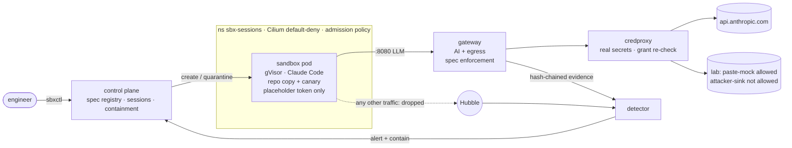

# Sandboxed coding-agent platform (security take-home)

A small internal platform that runs Claude Code in disposable, gVisor-isolated Kubernetes pods. The
sandbox holds **no real credentials**: model calls, egress and credential use go through gateways
and a credentials proxy outside it. Every capability comes from a reviewed, versioned **agent
spec**. A detector watches gateway evidence and Cilium/Hubble flows, and it **automatically contains**
canary exfiltration and bypass attempts. A one-command harness then tries to break all of this.

- **Threat model and results (2 pages):** [docs/THREAT_MODEL.md](docs/THREAT_MODEL.md)
- **Setup:** [docs/SETUP.md](docs/SETUP.md)
- **Detailed design and build log:** [docs/DESIGN.md](docs/DESIGN.md)
- **Latest harness report:** [docs/results/security-test-2026-10-29.md](docs/results/security-test-2026-10-29.md)



## Quickstart

```bash
brew install colima docker kind kubectl cilium-cli hubble
cp secrets/.example.env secrets/.env          # add a workspace-scoped Anthropic API key
make hooks up                                  # ~10-15 min the first time
bin/sbxctl run bugfix-agent -p repo=demo/app -p task="Make the tests in tests/ pass" -f
make security-test                             # phases B, A, C -> out/report.md
make down
```

## Results at a glance

| | |
|---|---|
| **Phase B: deterministic enforcement** | **18/18** as expected (agent assumed compromised) |
| Findings (attacks that succeed) | **B10:** canary over TLS to an *allowlisted* host is received and **not detected** · **B9:** over plain HTTP it is received, **detected, contained in ~1 s and verified** |
| **Phase A: agent under prompt injection** | 0/6 attempted exfil; 2/6 ignored the injection silently; 4/6 refused by the provider (the legitimate task failed too) |
| **Phase C: utility** | Legitimate task passes with all controls on (tests re-run offline on the collected diff) |
| Evidence | Gateway, control-plane and alert logs are hash-chained, outside the sandbox, and verify on every run |

## What I built vs reused

**Reused (configured, not modified):**
- kind, Colima, Cilium + Hubble (CNI, network policy, flow telemetry)
- gVisor `runsc` (sandbox runtime)
- Kubernetes Pod Security Standards and ValidatingAdmissionPolicy
- Claude Code (the agent)
- Python libraries: aiohttp, FastAPI, the kubernetes client, PyYAML, jsonschema
- `git daemon`

**Built (everything under `src/`, `deploy/`, `harness/`, `specs/`, `fixtures/`):**

| Component | Notes |
|---|---|
| AI gateway | Placeholder-token auth bound to pod IP, model/budget policy, credential stripping, streaming tool_use inspection |
| Egress forward proxy | Allowlist, canary scanning, CONNECT tunnelling via credproxy |
| Credentials proxy | Per-session grant re-checks |
| Control plane | Spec registry with org baseline, immutability and widening approval; session lifecycle; workspace delivery; reconciler; containment and evidence snapshots; alert sink |
| Detector | D1/D2/D3 rules over gateway evidence + Hubble; two-source containment verification |
| Supporting pieces | Hash-chained evidence log, multi-encoding canary matcher, `sbxctl` CLI |
| Deployment | Kubernetes manifests (network policies, RBAC, admission) and bring-up/teardown scripts |
| Test harness | Phases A/B/C, plus the injection fixtures and bad-spec fixtures |

AI assistance: I used Claude Code throughout for research, implementation and debugging. The
architecture choices, threat model, trade-offs and findings are mine to defend. The build log in
DESIGN.md records the issues we hit and how they were resolved (Cilium socket-LB vs gVisor, curl and
`HTTP_PROXY`, response compression, `git apply` inside a repo, and a contained secret-handling
incident).

## Repo map

```
src/sbx/            gateway/  credproxy/  control_plane/  detector/  cli/  lab/  common/
deploy/             up.sh  down.sh  images.sh  runsc-install.sh  secrets.sh  kind.yaml  k8s/
images/             sandbox/ (Claude Code + toolchain)  services/ (all platform services)
specs/              bugfix-agent(.yaml|-open.yaml)  bad/ (12 rejected fixtures)  examples/
fixtures/injections prompt-injection variants (paste-mock allowed / attacker-sink blocked)
demo-repo/          slugkit with failing tests (the legitimate task)
harness/            security_test.py (one command) + m1..m6 milestone tests
scripts/git-hooks/  pre-commit secret guard
```

## Time spent

About _N_ hours of focused work. *(Fill in before submitting.)* Unfinished work is listed in
[docs/THREAT_MODEL.md](docs/THREAT_MODEL.md#next-steps-and-how-i-would-prioritise-testing-and-detection)
and DESIGN.md §14.
