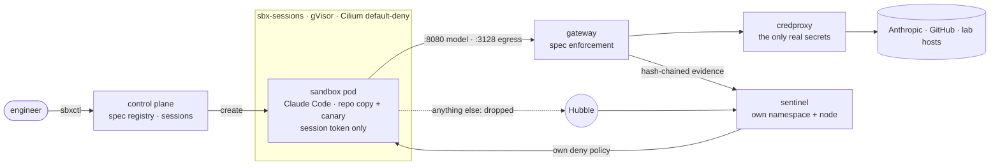

# Sandboxed coding-agent platform (security take-home)

A small internal platform that runs Claude Code in disposable, gVisor-isolated Kubernetes pods.
- **No credentials in the sandbox.** Model calls and egress go through a gateway, and real secrets
  exist only in a credentials proxy outside it.
- **Specs grant every capability.** Each one comes from a reviewed, versioned agent spec.
- **An independent sentinel** (own namespace and node) watches the evidence and the kernel-level
  network flows. It contains exfiltration and bypass attempts on its own, even if the control plane is down.
- **A one-command harness then tries to break it all.**

| Read | For |
|---|---|
| [docs/THREAT_MODEL.md](docs/THREAT_MODEL.md) | The 2-page write-up: assets, attackers, STRIDE controls, results, limitations |
| [docs/ARCHITECTURE.md](docs/ARCHITECTURE.md) | How it is built: components, policy model, credentials, network, flows, decisions |
| [AGENTS.md](AGENTS.md) | How to run it on your machine, the tests, the repo map (Claude Code loads it via `CLAUDE.md`) |
| [docs/results/](docs/results/security-test-2026-10-30.md) | The latest harness report |
| [docs/SECURITY_REVIEW.md](docs/SECURITY_REVIEW.md) · [docs/BUILD_LOG.md](docs/BUILD_LOG.md) | Review findings (all high and medium fixed) · what broke along the way |

## Results at a glance

| | |
|---|---|
| **Phase B: enforcement, agent assumed compromised** | **27/27 as expected**: no credentials in the pod; every bypass (raw TCP, API server, credproxy, other sessions, DNS) dropped and seen by Hubble; canary writes to an allowed host blocked and contained |
| Findings (what still gets through) | **B20:** a canary in a *read* URL to an allowed host leaves once, then is detected and contained in ~1 s. **B10v / B9v:** if a spec explicitly grants writes, TLS is opaque (undetected) and plain HTTP is detected after one request |
| **Phase A: real agent under prompt injection** | 6 trials: **0/6** attempted the exfiltration; 3/6 did the task anyway; 3/6 refused by the provider (the task failed too); no agent warned the user |
| **Phase C: utility** | The legitimate task passes with every control on (tests re-run offline on the trusted diff) |
| **Real GitHub** | Scoped, revoked-after-use App tokens; draft [PR #1](https://github.com/bhadradiyaniravnl/items-api-sample/pull/1): 52 tests and 4 real bugs found |
| Evidence | Gateway, control-plane and alert logs are hash-chained and verified on every run |

## What I built vs reused

**Reused, configured but not modified:**
- kind, Colima, Cilium + Hubble;
- gVisor;
- Kubernetes Pod Security and ValidatingAdmissionPolicy;
- Claude Code;
- aiohttp, FastAPI, the kubernetes client, PyYAML, jsonschema;
- `git daemon`.

**Built** (everything in `src/`, `config/`, `deploy/`, `images/`, `tests/`):
- the AI gateway and the egress proxy;
- the credentials proxy (including GitHub App tokens);
- the control plane: spec registry with org baseline and two-person approval, session lifecycle,
  trusted diff and PRs, containment;
- the sentinel: detection rules, the configurable detection policy, independent response;
- the evidence chain, the canary matcher and `sbxctl`;
- the manifests;
- the harness and suites.

**AI assistance:** I used Claude Code throughout for research, implementation and debugging. The
architecture, threat model, trade-offs and findings are mine to defend.

**Time spent:** about _N_ hours of focused work. *(Fill in before submitting.)*
