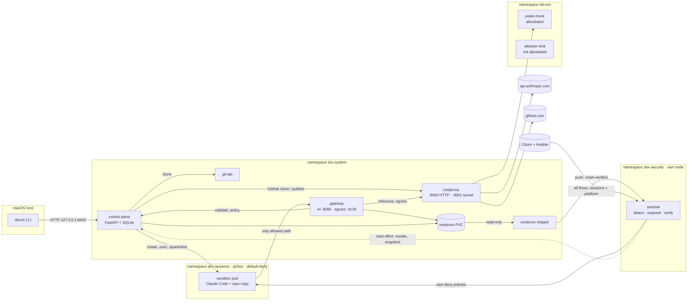
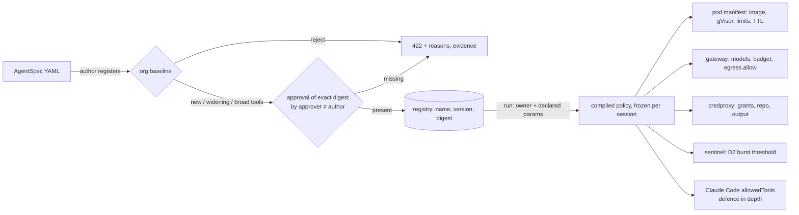
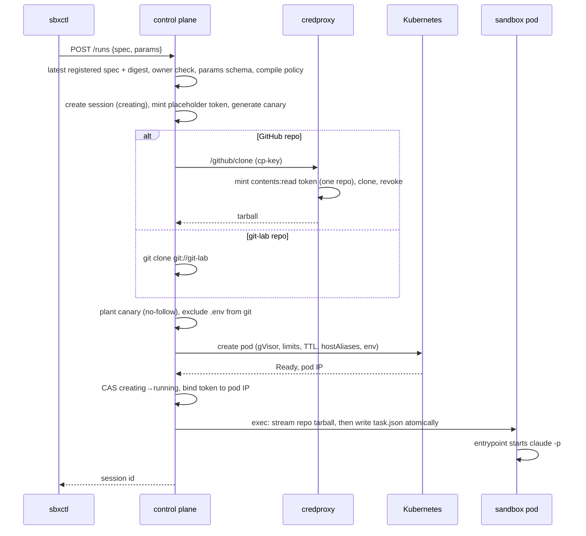
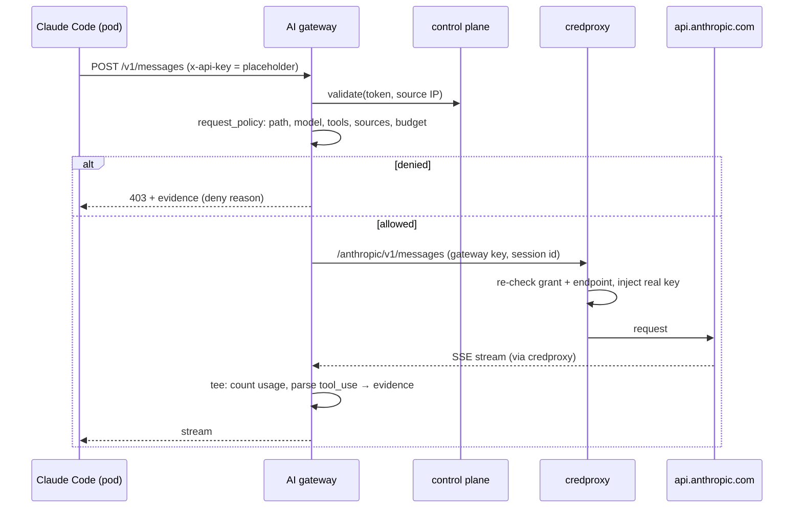
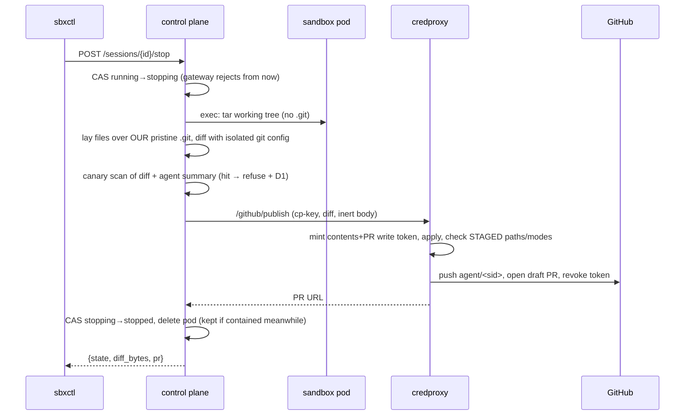
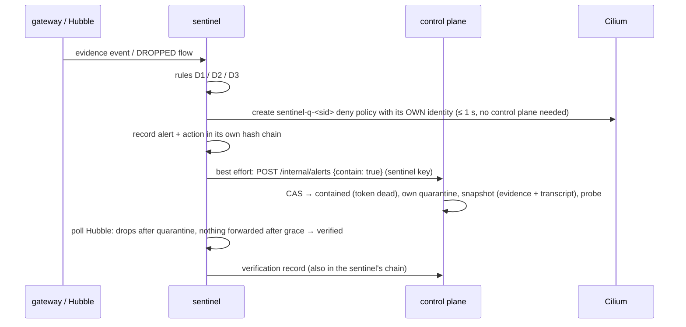

# Architecture

This document describes the sandboxed coding-agent platform as built: what each part does, how
requests flow through it, where every credential lives, and why it is shaped this way. Threats, findings
and evidence are in [THREAT_MODEL.md](THREAT_MODEL.md) and [SECURITY_REVIEW.md](SECURITY_REVIEW.md); what
broke along the way is in [BUILD_LOG.md](BUILD_LOG.md); how to run it is in [AGENTS.md](../AGENTS.md).

## 1. What the system does

An engineer runs `sbxctl run <spec>`. The platform then:
1. starts a **disposable, gVisor-isolated Kubernetes pod**;
2. gives it a **copy** of a repository;
3. runs **Claude Code** on a task inside it, streaming progress to the CLI;
4. accepts follow-up instructions while the session runs;
5. on `stop`, collects the agent's changes and, for GitHub repositories, opens a **draft pull request**.

Throughout, the agent is treated as **untrusted**: it may be prompt-injected by the code it reads, or
fully compromised. Nothing the agent can reach holds a real credential. Every capability comes from
a reviewed **agent spec**, enforced by components outside the sandbox. Exfiltration attempts are
**detected and contained automatically**, with evidence the agent cannot touch.

## 2. Design principles

1. **The sandbox holds nothing worth stealing.** It holds a placeholder token, valid only from its own pod IP and only while the session runs. Real credentials live in one pod, the credentials proxy.
2. **Every capability comes from the spec; enforcement happens outside the agent.** Claude Code's own tool permissions are defence in depth, never the boundary.
3. **The boundary is structural first and content-aware second.** The network decides *where* traffic can go (Cilium); the gateways decide *what* is allowed (L7 policy). Content scanning (canaries) is detection, not prevention.
4. **Anything the agent produces is attacker-controlled.** That includes its stdout, its summary, its diff, its workspace config and its account of its own actions. We recompute from trusted state, render it inert, or refuse to load it.
5. **Evidence comes from outside the sandbox.** The gateway, control plane and Cilium/Hubble write it; the agent never does. Records are hash-chained and attributable to user, session and spec digest.
6. **Enforcement claims have tests.** The boundary is proven by deterministic tests that assume a compromised agent, not by the model choosing to behave. Where a control is covered only by code review, [COVERAGE.md](COVERAGE.md) says so.

## 3. System overview



The sandbox has exactly **one** reachable destination, the gateway Service. **credproxy is the only
pod with a route out of the cluster.** Everything else is reached through those two.

## 4. Deployment topology

```
macOS (Apple M2 Pro)
└── Colima VM "sbx" (Linux arm64, 6 CPU, 8 GB)          docker engine
    └── kind cluster "sbx" (Kubernetes 1.37)
        ├── node sbx-control-plane   Kubernetes control plane; sbx/pool=security: sentinel (ns sbx-security) only
        ├── node sbx-worker          sbx/pool=platform: control-plane · gateway (+ evidence shipper) · credproxy ·
        │                            git-lab · lab-ext (runc), evidence and cp-data volumes
        ├── node sbx-worker2         sbx/pool=sandbox, tainted: sandbox-<sid> pods only (gVisor installed only here)
        └── Cilium 1.20 (CNI, kube-proxy replacement, Hubble relay, socketLB.hostNamespaceOnly) on all nodes
```

| Workload | Image | Ports | Holds | Can reach |
|---|---|---|---|---|
| control-plane | `sbx/services` | 8000 (NodePort 30443 → `127.0.0.1:8443`) | SQLite (sessions, specs, approvals); controller SA; caller keys; `cp-key` | API server, credproxy, git-lab |
| gateway | `sbx/services` | 8080, 3128 (ClusterIP `10.96.100.10`) | `gateway-key`; evidence (rw) | control plane, credproxy |
| credproxy | `sbx/services` | 9000, 9001 | **Anthropic key, GitHub App key**; `credproxy-key`; `cp-key` | control plane, lab-ext, `api.anthropic.com`, `github.com`, `api.github.com` |
| sentinel (ns `sbx-security`, security node) | `sbx/services` | 9100 (ingest), 127.0.0.1:9101 (admin) | `sentinel-key`, `ingest-key`; own volume; SA limited to Cilium policies + pod list in `sbx-sessions` | Hubble relay, API server, control plane |
| gateway sidecar: evidence-shipper | `sbx/services` | — | `ingest-key`; evidence (ro) | sentinel |
| git-lab | `sbx/services` | 8080 (`git://`) | demo repos | — (control plane only inbound) |
| sandbox-&lt;sid&gt; | `sbx/sandbox` or `sbx/sandbox-pyweb` | — | repo copy, canary, placeholder token | gateway only |
| paste-mock / attacker-sink | `sbx/services` | 8080, 8443 | receipt log (ground truth) | — (credproxy only inbound) |

`deploy/up.sh` builds all of this idempotently (`make up`), and `deploy/down.sh` exports evidence and
removes it. A full rebuild takes about 5 minutes with cached images.

## 5. Components

### 5.1 `sbxctl` (host CLI)

`src/sbx/cli/sbxctl.py` uses only the standard library and talks to the control plane on `127.0.0.1:8443`.
- **Commands:**
  - `run`, `ls`, `status`, `logs [-f]`, `send [-f]`, `attach`, `stop`, `diff`, `destroy`;
  - `contain`, `alerts`;
  - `spec register | approve | ls`.
- **Identity:** the user is sent as `X-User` (prototype; OIDC in production).
- **Display:** stream-json is condensed into readable progress, and **all agent-derived text is passed through `safe()`**, which renders control characters as visible `\xNN` escapes, so agent output can't drive the terminal.

### 5.2 Control plane

A FastAPI app (`src/sbx/control_plane/`) and the only component with Kubernetes access. Its
ServiceAccount is limited to the `sbx-sessions` namespace: pods, logs, exec, and Cilium policies.

| Module | Responsibility |
|---|---|
| `app.py` | Public API (runs, sessions, specs, alerts) and internal API with **per-component scopes** |
| `specs.py` | Spec registry: author check, **two-person approval**, widening analysis, compile spec → policy |
| `baseline.py` | Org baseline as code: schema, approved images/models/destinations/secrets, limits |
| `sessions.py` | Lifecycle: run, workspace delivery, follow-ups, stop (trusted diff, PR), contain, destroy, reconciler |
| `k8s.py` | Pod manifest, exec, logs, quarantine CiliumNetworkPolicy |
| `store.py` | SQLite with a lock and **compare-and-set state transitions** |

**Public API:**

| Endpoint | Purpose |
|---|---|
| `POST /runs` | Start a session (spec + declared params) |
| `GET /sessions`, `/sessions/{id}` | List and status |
| `GET /sessions/{id}/logs?follow&tail` | Progress stream (untrusted) |
| `POST /sessions/{id}/messages` | Follow-up instruction |
| `POST /sessions/{id}/stop` | Revoke, compute diff, maybe open PR, delete pod |
| `GET /sessions/{id}/diff` | Result |
| `POST /sessions/{id}/contain` | Manual containment |
| `DELETE /sessions/{id}` | Destroy (contained: security admins only) |
| `POST /specs`, `POST /specs/approvals`, `GET /specs` | Registry |
| `GET /alerts` | Alerts with containment and verification |

**Internal API**, keyed per component:

| Endpoint | Caller |
|---|---|
| `POST /internal/validate` | gateway |
| `GET /internal/policy/{sid}` | gateway, credproxy, sentinel |
| `POST/GET /internal/alerts`, `POST /internal/alerts/verification` | sentinel |

There is deliberately **no internal way to create a session**.

**State is durable:** SQLite lives on the `cp-data` PVC. At startup, a sweep removes any session pod the registry doesn't know as live, failing closed. A `meta` table holds the fleet-freeze flag.

**Fleet kill switch:** `POST /admin/freeze` (security admins only) moves every live session to `contained` with compare-and-set, applies one namespace-wide Cilium deny policy (`freeze-all-sessions`), and refuses new runs. `unfreeze` lifts the network policy, but frozen sessions stay contained until an admin releases them.

**Untrusted-content scan** (`content_scan.py`): at clone time, repo text is scanned for instruction-like content aimed at agents (directives, override phrases, concealment cues, secret-sending commands, hidden Unicode). Findings go to evidence, a low `INJ` alert and the PR body, because agents rarely tell the user what they saw.

**Idle and lifetime reaper:** resources are freed without waiting for the hard TTL.
- **Activity** means gateway token validations (every model or egress call) plus follow-up messages. These are signals the agent can't fake from inside the pod.
- **Idle:** a running session idle longer than `spec.runtime.idleTimeout` (default 10 min; the baseline allows 30 s to 1 h, never above the TTL) gets a normal `stop`: trusted diff, draft PR if configured, transcript saved, workdir and pod deleted. The reason is recorded, e.g. `idle 602s (limit 600s)`.
- **Max lifetime:** sessions are stopped cleanly 60 s before the kubelet's hard TTL kill.
- **Contained sessions:** released after `SBX_CONTAINED_RETENTION_HOURS` (default 2); the snapshot and transcript are taken at containment.
- **Trade-off:** a tool run longer than the idle timeout with no model calls in between looks idle, so the timeout is per spec.

**Session states:** `creating → running → stopping → stopped → destroyed`. Side exits are `failed`,
`ended` (pod lost or TTL hit) and `contained`. Every change is a compare-and-set, so containment
can't be overwritten by a concurrent `stop`, or revived by a slow start.

### 5.3 Sandbox pod

**Images:**
- `images/sandbox`: Node 24, Claude Code 2.1.1, git, Python, pytest, jq, ripgrep.
- `images/sandbox-pyweb` adds FastAPI, httpx and pytest, a *per-repo image*, so no package egress is needed.

**Hardening:**
- `runtimeClassName: gvisor`;
- non-root (uid 1000), read-only root filesystem, all capabilities dropped, `RuntimeDefault` seccomp;
- no service-account token, no service links;
- `dnsPolicy: None` with a dead resolver, so **no DNS**;
- the gateway is found through `hostAliases`, pointing at a fixed ClusterIP;
- `activeDeadlineSeconds` is the TTL;
- CPU and memory limits come from the spec.

**Environment:**
- `ANTHROPIC_BASE_URL=http://gateway:8080`;
- `ANTHROPIC_API_KEY=<session placeholder>`;
- HTTP(S) proxy variables pointing at `gateway:3128` with the session ID and token;
- model variables from the spec;
- non-essential Claude Code traffic disabled.

**Entrypoint** (`images/sandbox/entrypoint.sh`):
1. Wait for `/workspace/.sbx/task.json`.
2. Run `claude -p` with the spec's `--allowedTools`, `--setting-sources user` and `--strict-mcp-config`, so repo-supplied Claude settings and MCP config are ignored.
3. Serve follow-ups from `/workspace/.sbx/inbox/<n>.json` with `--continue`, so the conversation resumes in the same workspace.

### 5.4 Gateway

One Python process (`src/sbx/gateway/`) with two listeners. Each request:
1. validates the placeholder token **and** the source pod IP (`/internal/validate`, 1 s cache);
2. loads the compiled policy;
3. writes an evidence event;
4. forwards to credproxy with a session tag, never a secret.

**AI gateway (`:8080`)**, an Anthropic API reverse proxy:
- **Request policy** (`request_policy()`):
  - only `POST /v1/messages` and `/v1/messages/count_tokens`;
  - a top-level `model` from the spec;
  - only `custom` tools;
  - no `mcp_servers` or `container`;
  - content `source` limited to `base64`, `text` or `content`.

  This blocks provider-side egress: server tools such as `web_fetch`, and URL or file sources the provider would fetch.
- **Budget:** cumulative token budget per session.
- **Credentials:** client-supplied credentials are stripped.
- **Inspection:** streamed responses are parsed for `tool_use` blocks, so evidence shows what the model *asked to do*, independent of whether it happened (input to D3).

**Egress gateway (`:3128`)**, a hand-written authenticated forward proxy:
- **Plain HTTP:** the full request is visible. URL, headers and body are canary-scanned, the host is checked against `egress.allow`, and the request is forwarded via credproxy `/egress`. **Write-capable destinations** (marked `accepts_writes` in the baseline catalogue) accept only GET/HEAD unless the spec lists them in `egress.writeAllowed`.
- **CONNECT:** only host and port are visible, so a tunnel counts as a **write**. It is allowed only to write-allowed hosts and tunnelled via credproxy `:9001`; the payload is opaque (B10v).
- **Limits per sandbox IP:** 16 concurrent connections; 16 MB body, size-checked before reading; 30 s body timeout; 32 MB response cap.

### 5.5 Credentials proxy

`src/sbx/credproxy/` is the **only holder of real secrets** (mounted Secrets) and the only pod with
external egress.

| Route | Caller | Does |
|---|---|---|
| `/anthropic/v1/messages[...]` | gateway key only | Re-checks session state and the `anthropic/default` grant and the endpoint allowlist; injects `x-api-key` (and the workspace header if configured); requests uncompressed responses |
| `/egress` | gateway key only | Re-checks the destination against the session's `egress.allow`; forwards plain HTTP |
| `:9001` tunnel | gateway key only | One-line JSON handshake (session, host, port), then raw bytes for CONNECT |
| `/github/clone` | control-plane key only | Mints a **`contents:read` token for that one repo**, clones, revokes, returns a tarball |
| `/github/publish` | control-plane key only | Mints **`contents` + `pull_requests: write` for that one repo**, applies the diff, checks the **staged** paths and modes (protected paths, no symlinks or submodules), pushes `agent/<sid>`, opens a **draft PR**, revokes |

GitHub tokens are GitHub App installation tokens, minted per operation from the App's private key
(JWT, RS256). git receives them through an in-memory `http.extraHeader`, never on disk or in a URL,
and they are revoked with `DELETE /installation/token` straight after use. GitHub operations always
use an **uncached** policy lookup.

### 5.6 Sentinel (continuous detection and response)

**What it can see**, and how far to trust each part:
- **Kernel truth:** Hubble flows from session **and** platform pods, i.e. where every connection went and whether it was dropped. No pod can fake these.
- **Platform claims:** shipped gateway and control-plane evidence (model calls, tool calls, egress decisions, lifecycle). It can't be edited or dropped after the fact without an EV alert, but it could be incomplete.
- **Not seen yet:**
  - processes and files inside gVisor;
  - Kubernetes API actions (next step: an audit webhook);
  - platform-pod processes (next step: Tetragon).
- **Completeness check (S1):** Cilium's L7 proxy parses every sandbox request to the AI gateway
  (method, path, session labels; credentials redacted by Hubble), and every connection to the egress
  proxy is a SYN. The sentinel counts both per session and reconciles them with the shipped gateway
  evidence, so a gateway that silently stops logging is caught (S1).
  It checks counts, not content: a gateway that logs one benign-looking record per request is not
  caught. The test stands in for a compromised gateway with a fault-injection switch (`SBX_FAULT_INJECTION=1`,
  `gateway/shared.py`: drop evidence for the sessions listed in `/tmp/sbx-fault/drop-sessions`) that the
  suite sets on the gateway for its run and removes on exit; the shipped manifests never enable it.

`src/sbx/sentinel/` is a separate security plane in its own namespace (`sbx-security`) on its own
node (`sbx/pool=security`). The platform has no permissions there and no network path in, except the
evidence shipper's push.

**Sources:**
- **Shipped platform evidence.** A sidecar in the gateway pod (`shipper.py`) pushes every record of
  `gateway.jsonl` and `control-plane.jsonl`. The sentinel checks **sequence continuity and the hash
  chain on arrival** and keeps its own copy, so a gap or edit raises EV.
- **Hubble, from session pods and from platform pods.** This comes from the kernel datapath, so no
  platform pod can fake it.

**Built-in rules** (`rules.py`, pure functions; the actions shown are those set in `config/sentinel/detection.yaml`):

| Rule | Signal (source) | Action |
|---|---|---|
| **D1** | Canary (plain, base64 at any alignment, hex, URL-encoded) in egress (shipped gateway evidence) | High; **auto-quarantine** |
| **D2** | Spec denial (gateway) or DROPPED flow from a session pod (Hubble); first one, then the spec's burst threshold | Medium, then high; **auto-quarantine** at the burst |
| **D3** | Model `tool_use` with the canary, or an *acting* tool (Bash, WebFetch, MCP) referencing `.env` or a non-allowed host | Medium alert |
| **EV** | Shipped evidence: sequence gap or hash-chain break | High alert |
| **S2** | **Platform pod** (gateway, credproxy, control plane…) has a policy-dropped connection, or reaches the outside world when it isn't credproxy, or credproxy reaches a name outside its allowlist | High alert (isolating platform pods needs approval) |
| **S1** | Gateway evidence incomplete: the datapath (Hubble L7 for the AI gateway, L4 connections for the egress proxy) saw at least 3 more requests than the gateway logged, and at least 25% of them, over a window that ended 20 s ago | High; **quarantine** the session |
| **S6** | Traffic still forwarded from a session after its containment took effect (e.g. a compromised control plane lifted its own quarantine) | High; **re-quarantine** |

The control plane still raises D1 itself for a canary in a PR diff or agent summary, and INJ for the
content scan.

**Detection policy: rules and response actions as configuration** (`config/sentinel/detection.yaml`,
`detection_policy.py`). It works like agent specs, but for the security plane. **The file is the only source of values:**
the code implements the detectors and knows which parameters each one takes, but holds no severities, responses,
thresholds or allowlists. A policy that leaves out a built-in rule, a parameter or the response actions is rejected
rather than run on a hidden default.
- **Response actions** are named lists of steps: `quarantine` (the sentinel's own deny policy), `verify` (Hubble check),
  `freeze` (fleet-wide deny) and `notify-control-plane` (revoke the token, snapshot evidence). Every alert is always written
  to the sentinel's own log. The shipped file defines `record`, `contain` and `freeze-fleet`.
- **Built-in rules** (above, plus POL for a rejected policy) must all be listed. The policy sets `enabled`, `mode`, `severity`, `response`, per-stage
  overrides (D2's first denial vs burst) and `params`: thresholds and allowlists such as D2's deny reasons and default burst,
  D3's acting tools, the S1 window and deficit, the S2 world allowlist and the S6 grace period.
- **Custom match rules** add a detection without a code change. Each has a `source` (`gateway`, `control-plane`,
  `hubble-sessions` or `hubble-platform`), field matchers (equals, `in`, `regex`, numeric comparisons, `exists`, `contains`),
  an optional `threshold` of a count within a window per session, pod or globally, a severity, a response and a summary
  template. Examples shipped: `GH-WRITE-ATTEMPT`, `MODEL-PROBING`, and `SANDBOX-DNS-EXFIL` (in monitor mode).
- **`mode: monitor`** records the alert and the steps it *would* have run, and does nothing else, so a new rule can be tuned
  before it is enforced.
- **The floor** is compiled into the image and cannot be configured away:
  - D1, EV, S6 and POL always stay enabled in enforce mode;
  - D1 and S6 must quarantine or freeze;
  - thresholds are bounded (e.g. an S1 deficit of 1–20, a D2 burst of 1–50);
  - only high-severity rules may freeze;
  - platform-flow rules cannot quarantine, because there is no session;
  - unknown fields, steps, params and bad regexes are rejected.
- **Deploy** with `make sentinel-policy`:
  1. validate the file and diff it against the active policy, inside the sentinel and with the same code that will load it;
  2. apply it as the ConfigMap `sentinel-detection` in `sbx-security`;
  3. hot-reload it (the sentinel also polls every 10 s);
  4. confirm the sentinel now runs exactly that file's digest.
- **A broken policy cannot blind the sentinel.** If one is applied by hand, the sentinel rejects it, raises a **POL** alert and
  keeps its last good policy. On first boot with no ConfigMap it starts on the copy of the same file baked into the image;
  if no valid policy is available at all it exits (CrashLoopBackOff) rather than run blind. Every load and every rejection is in its hash-chained log, with the digest and the rules disabled
  or in monitor mode.
- **Who can change it:** the sentinel's service account can only *read* that one ConfigMap. Writing it needs cluster access to
  `sbx-security`, which the platform's identities don't have. **Risk:** one person with that access can change detection
  without review (within the floor). Two-person approval of policy digests, as for agent specs, is the designed fix.

**Response is independent of the control plane:**
For a `contain` response (the steps the policy lists):
1. The sentinel creates its **own** Cilium deny policy (`sentinel-q-<sid>`) with its own service
   account. That account can only manage Cilium policies and list pods in `sbx-sessions`: no exec, no Secrets.
2. Then, best effort, it asks the control plane to revoke the token, snapshot evidence and record the alert.

If the control plane is down, step 1 still holds; this is tested with the control plane scaled to zero.
**Self-protection:** a ValidatingAdmissionPolicy lets only the sentinel's identity change or delete
`managed-by=sentinel` policies, so neither a compromised control plane nor a cluster admin using kubectl
can lift a sentinel quarantine or freeze.

**Verification** polls up to 60 s:
- *verified* only if Hubble shows the pod's traffic **dropped after the quarantine** and **nothing forwarded** after a 3 s grace period;
- with no traffic at all, the result is recorded as *inconclusive* rather than claimed.

**Record:** its own hash-chained log (`/data/sentinel.jsonl`, on its own volume) of alerts, actions
and verifications, plus the verified evidence copies.

**Operator interface:** a localhost-only admin API, reached with
`kubectl -n sbx-security exec deploy/sentinel -- python -m sbx.sentinel.ctl …`:
`status`, `alerts`, `freeze`, `unfreeze`, `release`, `policy`, `reload`, `validate`. Cluster access to `sbx-security` is the
authorisation, and it shows up in the audit log.

### 5.7 Evidence store

A PVC mounted read-write by the gateway and control plane, read-only by the evidence shipper (which copies it to the sentinel), and **never** by a sandbox.
- **Files:**
  - `gateway.jsonl`: every AI and egress decision, tool_use, canary match;
  - `control-plane.jsonl`: lifecycle, spec registrations and rejections, approvals, GitHub token use, PRs, messages (hash + length), containment;
  - `alerts.jsonl`: alert, containment and verification records linked by `alert_id`.
- **Integrity:** each record carries `seq`, `prev_hash` and `hash = sha256(prev_hash + record)`. `verify_chain()` detects edits and truncation.
- **On containment:** a snapshot goes to `sessions/<sid>/` (pod spec and status, session record, agent stdout, the session's gateway events, **Claude transcript**).
- **Reasoning chain:** the AI gateway stores every full prompt and response in `bodies/<sid>/<seq>.json.gz`, canary-redacted and linked to the hash-chained `ai_request` event. The Claude transcript is also saved at `stop`.
- **Retention:** the control-plane workdir (repo copy + canary) is deleted at `stop`; diffs expire after `SBX_RESULTS_TTL_DAYS` (default 7).

### 5.8 Lab services

- **`paste-mock` and `attacker-sink`** (`src/sbx/lab/sink.py`) accept HTTP and TLS and record every request. Their receipt logs are the **ground truth** for whether a canary left. Only credproxy can reach them.
- **`git-lab`** (`src/sbx/lab/git_lab.py`) serves `demo/app` and the injected variants over `git://`, reachable only by the control plane.

## 6. Policy model



**AgentSpec** (`config/agent-specs/*.yaml`) declares:
- runtime (image, RuntimeClass, resources, TTL) and models (allowlist, defaults, token budget);
- repo (allowed repos, read-only access, output: branch or **draft** PR with protected paths);
- agent tools, egress allowlist, secret grants, detection threshold;
- the only **parameters** a run may supply.

**Org baseline** (`baseline.py`) runs at registration:
- strict schema;
- approved image prefix and digest pinning (with a recorded dev exception for kind-loaded tags);
- gVisor only;
- TTL ≤ 2 h; CPU and memory caps;
- approved models, token cap;
- egress = exact hosts from an approved catalogue;
- secrets from the credproxy catalogue, and GitHub grants only for approved repos named in `repo.allow`;
- PR output must be a draft with CI paths protected;
- bounded string parameters that are never policy keys;
- unrestricted Bash needs `riskAcceptance`.

**Lifecycle:**
- Versions are immutable and monotonic.
- **New specs, any widening (computed over the whole compiled policy), and unrestricted Bash require a security approver other than the author** to approve the exact digest first.
- Shipped specs are bootstrapped through the same baseline.
- Runs always bind to the latest registered digest.

**Enforcement map:**

| Spec field | Enforced by |
|---|---|
| runtime | control plane (pod manifest), kubelet (TTL), gVisor, admission policy |
| model.allow, maxTokens | AI gateway |
| egress.allow | Cilium (gateway only) + egress gateway + credproxy |
| secrets | credproxy (grant re-check per request) |
| repo, output | control plane (clone, trusted diff) + credproxy (scoped tokens, staged-path check) |
| parameters | control plane (schema; unknown keys rejected) |
| detection | sentinel |
| agentTools | Claude Code (defence in depth only) |

## 7. Identity and credentials

| Credential | Lives in | Usable by | Lifetime / scope |
|---|---|---|---|
| Session placeholder token | sandbox env; SHA-256 in control-plane DB | gateway validation, from **that pod IP only** | until stop, contain, pod loss or TTL |
| Anthropic API key | credproxy Secret | credproxy (injected per request) | long-lived; workspace-scoped key with a spend limit |
| GitHub App private key | credproxy Secret (mode 0440, fsGroup) | credproxy (JWT signing) | long-lived |
| GitHub installation token | credproxy memory | one git or API operation | ≤ 1 h; one repo; read **or** write; revoked after use |
| Component keys (`gateway`, `credproxy`, `sentinel`), `ingest-key` | `sbx-internal` Secret, one per pod | that component, on its scoped endpoints | static (prototype; SPIFFE in production) |
| `cp-key` | control plane + credproxy | GitHub clone/publish | static |
| Controller ServiceAccount | control plane | pods, exec, logs, CNPs in `sbx-sessions` | Kubernetes-managed |
| User identity | `X-User` header | control plane public API | prototype; OIDC in production |

Real secrets enter the cluster only through `deploy/secrets.sh`, from gitignored files. A pre-commit
hook (`make hooks`) blocks secret-shaped content from git.

## 8. Network model

| Policy | Effect |
|---|---|
| `sessions-default-deny` (K8s NP) | Session pods: no ingress or egress by default |
| `sessions-allow-gateway` (CNP) | `sbx/state=running` pods → gateway pods on 8080/3128 only |
| `quarantine-<sid>` (CNP, created at containment) | `egressDeny` / `ingressDeny` to all for that session, **effective in ≤ 1 s** (relabelling took ~45 s) |
| `system-*` (CNPs) | One explicit path per platform component; DNS for platform pods only |
| `credproxy` (CNP) | Egress to lab-ext and `toFQDNs` `api.anthropic.com`, `github.com`, `api.github.com` |
| `lab-*` | Lab services accept only credproxy |
| `freeze-all-sessions` (CNP, created by `freeze`) | Namespace-wide deny for every session pod |
| `sbx-session-pods` (ValidatingAdmissionPolicy) | Session pods must use gVisor, target the **sandbox node pool**, mount no SA token, carry `sbx/session`, and mount no hostPath, Secret or projected volumes |

Two platform-level details matter:
- **gVisor and Cilium socket load balancing.** gVisor's network stack never calls the host `connect()`, so Cilium's socket-level Service translation doesn't apply to it. Cilium runs with `socketLB.hostNamespaceOnly=true`, so pod traffic uses per-packet load balancing.
- **Hubble sees what the gateway can't.** It records every dropped flow from a session pod, so bypass attempts that never reach the gateway are still observed and attributed through the pod's `sbx/session` label.

## 9. Key flows

### 9.1 Start a session



### 9.2 A model call



### 9.3 Stop: trusted diff and pull request



### 9.4 Detection, containment, verification



### 9.5 Follow-up messages

`sbxctl send` / `attach` → `POST /sessions/{id}/messages`. This is owner-only, running sessions only,
and ≤ 4000 characters. The control plane writes `inbox/<n>.json` atomically through exec, and the entrypoint runs
`claude -p … --continue`, so the agent resumes the same conversation. Evidence records the turn, length
and SHA-256, not the text. `attach` replays history and streams live.

## 10. Testing architecture

The one-command harness (`make security-test`: phases A, B, C) and nine feature suites (`make test` runs eight; `github` needs the optional App) are listed,
with what each proves and costs, in [AGENTS.md](../AGENTS.md#5-test-it). Harness rules:
- Verdicts come only from outside the sandbox.
- Nondeterministic agent outcomes are kept separate from enforcement results.
- Task success is re-checked by applying the recomputed diff in a fresh `--network none` container.

## 11. Key decisions and trade-offs

| Decision | Alternatives | Why this one |
|---|---|---|
| Explicit gateways (agent configured via base URL and proxy env) | Transparent TLS-intercepting chokepoint | Semantic visibility (model requests, tool_use) without a MITM CA in the sandbox. Bypassing the env vars fails closed at the network. The cost is that CONNECT is opaque (B10). |
| gVisor in kind | Kata/Firecracker; plain runc | Large attack-surface reduction with no KVM (the M2 has no nested virtualisation). MicroVMs remain the production design. |
| Cilium + Hubble | Plain NetworkPolicy; iptables | FQDN egress for credproxy, deny policies for fast quarantine, and **independent flow telemetry** for bypass attempts. |
| Per-session deny policy for containment | Relabel the pod | ≤ 1 s against ~45 s (a relabel forces a new Cilium identity). |
| Credentials only in credproxy, per-operation GitHub App tokens | PAT; token in the sandbox; token returned to the control plane | Tokens never leave one pod, are least-privilege per operation, and are revoked immediately. |
| Control plane computes the diff | Trust `git diff` in the pod | The pod's git, config and output are attacker-controlled. |
| Spec registry with two-person approval | Annotations; trust authors | Self-asserted approvals are worthless; approving the exact digest binds review to bytes. |
| Hash-chained JSONL evidence on a PVC | Directly to a SIEM | Simple and verifiable locally. WORM + SIEM is the production path. |
| Per-repo sandbox image | Install dependencies at run time via a mirror | No package egress during the agent phase. A mirror is designed for repos that need it. |

## 12. Built vs designed

| Area | Built | Designed (production path) |
|---|---|---|
| Isolation | gVisor on a dedicated tainted node; restricted PSS; admission policy | Kata/Firecracker microVMs on separate machines; pod creation restricted to the controller identity |
| Identity | Per-component keys; `X-User` | SPIFFE/mTLS; OIDC |
| Workspace delivery | exec (tarball chunks) | Prepared volumes, no `pods/exec` |
| Egress | Explicit proxy, allowlist, plain-HTTP canary scan | TLS inspection + DLP for write-capable destinations; package mirror |
| Evidence | Hash chain; verified copy in the sentinel's own zone; snapshots, transcripts, prompt/response bodies | WORM storage + SIEM, external anchor |
| GitHub | App tokens, draft PRs, protected paths | Branch rulesets, CODEOWNERS, SAST/secret scanning on agent PRs |
| Supply chain | Pinned versions, checksums | Digest-pinned and signed images, SBOM, verified at admission |
| Resume | Follow-ups resume the conversation in the same pod | Resume after `stop` (snapshot workspace + transcript) |

## 13. Repository map and versions

The repository map is in [AGENTS.md](../AGENTS.md#repo-map). **Pinned versions:**
- kind v0.33 (Kubernetes 1.37), Cilium 1.20.1, gVisor release-20261019, Hubble CLI 1.20.2;
- Claude Code 2.1.1;
- Python 3.12 services: aiohttp, FastAPI, the kubernetes client, PyJWT.
